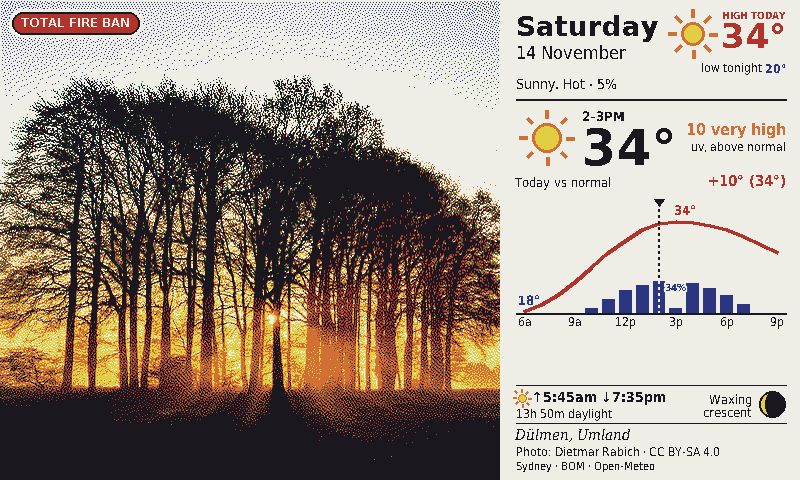
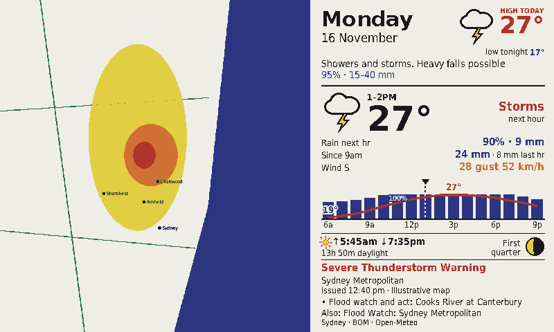
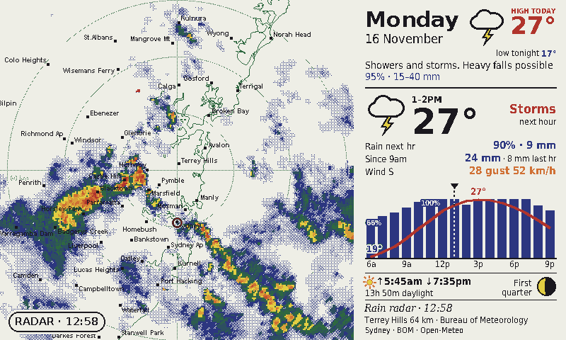
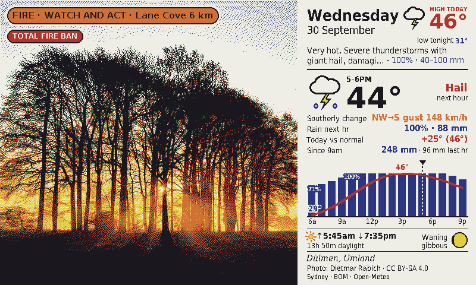
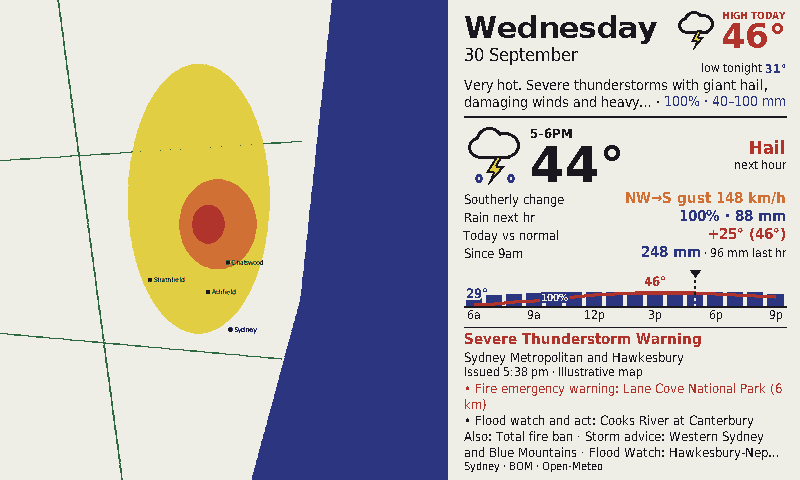
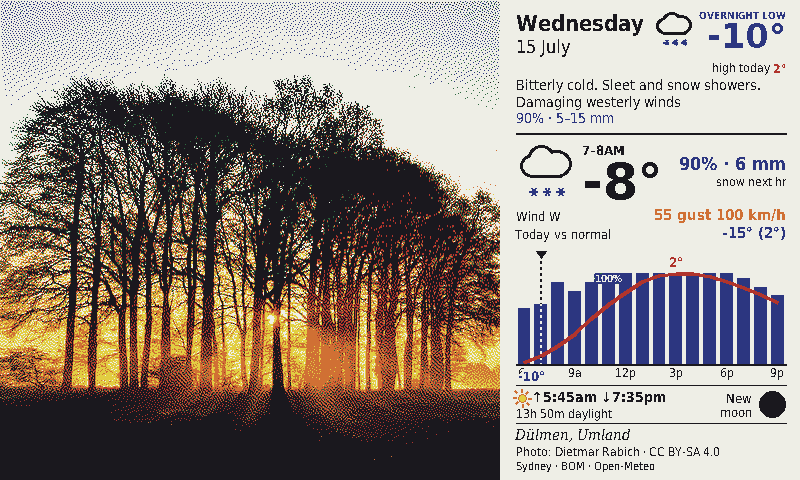

# Inky Almanac

**A calm, colourful daily poster for the Pimoroni Inky Frame 7.3".**
A new landscape photograph every day, beside the weather that matters in the
coming hour, with hazard warnings for your area when there are any. It
redraws about once an hour and holds still the rest of the time, which suits
a seven-colour e-ink panel that takes 40 seconds to redraw. When a severe
storm warning lands, it shows the warning map within minutes; press a button
and it shows the rain radar.

| | |
|---|---|
|  |  |
| **A normal afternoon.** The coming hour leads, with what's unusual about it. | **An evening.** From 6 pm it describes tomorrow, so the last redraw still helps at breakfast. |
|  |  |
| **A warning in force.** The warning's map replaces the photo and the panel lists what's in force (the map here is a test fixture). | **Radar mode** (button C), drawn from a recorded BOM radar frame of heavy rain over Sydney on 16 November 2026. |

All images are made by the real renderer for central Sydney, in estimated
ink colours. **What every small behaviour means, and why: [docs/behaviours.md](docs/behaviours.md).**
**Try it in your browser: [the playground](https://abradner.github.io/inky-almanac/).**

## What's on it

- **A photograph worth looking at**: a Wikimedia Commons *Featured Picture*
  of mountains, forests, lakes or volcanoes, screened for colours the inks
  can show, credited on the poster.
- **The coming hour, large**: its sky, its temperature and the most unusual
  thing about it, then up to four more facts ranked by how far out of the
  ordinary they are. Hail and storms always lead.
- **The day**: the Bureau of Meteorology's forecast for your town, and the
  next extreme (the overnight low in the morning, the high by day).
- **What actually happened**: rain since 9 am from a real BOM rain gauge,
  and southerly changes seen at the coast before they arrive.
- **An hourly strip** of temperature and rain chance, sunrise, sunset and a
  southern-hemisphere moon.
- **Hazards near home**, only when there are any: RFS fires, SES floods and
  storms, BOM warnings, Total Fire Bans, high fire danger, smoke.

## Extremes: how the layout adapts

| | |
|---|---|
|  |  |
| **46° with hail.** Hail leads (hazards always outrank everything); the southerly change ranks second, ahead of 88 mm of rain; "vs normal" shows +25°. The forecast text stops at two lines with an ellipsis. | **The same hour beside a warning map.** The panel widens to 322 px, the chart shrinks and the sun row gives way so the whole warnings list fits; the fire emergency is red. |
|  | |
| **−10° at 7 am.** Before 9 am the overnight low leads, in blue. Snow in the coming hour reads "snow next hr"; a 100 km/h westerly ranks next, then −15° against normal. | |

## Quick start

You need an **Inky Frame 7.3"** (the Pico W model), a machine that runs
**docker** on the same network, and a computer with USB for the first
install. The tooling (`mpremote`, Python, pytest) comes from `mise install`.

1. **Configure the renderer.** `cp server.env.example server.env`, then set
   your place, latitude, longitude and BOM forecast town (`ALMANAC_*`; every
   setting and its default is in [docs/development.md](docs/development.md#configuration)).
   The defaults are central Sydney, so it works unconfigured.
2. **Run the renderer** on the docker machine:
   ```bash
   docker build -t inky-almanac:dev server
   docker run -d --name inky-almanac --restart unless-stopped -p 8077:8077 \
     --env-file server.env -v inky-almanac-cache:/var/cache/almanac inky-almanac:dev
   ```
   It fetches every feed before it starts listening (up to a minute).
   To deploy to another host over ssh instead, fill in `deploy.env` (from
   `deploy.env.example`) and run `scripts/deploy-server.sh`.
3. **See a poster without a frame**: open `http://<host>:8077/` (status
   page) or `/preview.png`. Add `?at=2026-11-14T19:30` to see any moment.
4. **Flash the frame** with Pimoroni's MicroPython build
   `pico_w_inky-v1.29.0-micropython.uf2`
   ([release v1.29.0](https://github.com/pimoroni/inky-frame/releases/tag/v1.29.0)):
   hold BOOTSEL on the back while plugging in and copy the `.uf2` onto the
   `RPI-RP2` drive. Back up the stock files first if you want them
   (`mpremote fs cp -r :. ./stock-fs`).
5. **Configure and install the frame app.** `cp frame/config.py.example
   frame/config.py` and set `SERVER = "http://<renderer IP>:8077"`. Copy
   `frame/WIFI_CONFIG.example.py` somewhere private, fill in your Wi-Fi, and
   with the frame on USB run:
   ```bash
   scripts/deploy-frame.sh --local --clean-stock --wifi-config PATH/TO/WIFI_CONFIG.py --reset
   ```
   For over-the-air updates later, make a key once
   (`scripts/sign_ota.py --new-key ~/.config/inky-almanac/ota-key.txt`) and
   add `--ota-key` with that path; see [docs/operations.md](docs/operations.md#over-the-air-updates).
6. **First boot.** After the reset the frame joins Wi-Fi, fetches the poster
   and draws it (about 40 seconds). From then on it wakes at a minute past
   each hour from 6 am to 10 pm. If the frame's network is firewalled, allow
   the frame to reach the renderer on TCP 8077; nothing needs to reach the
   frame.

Buttons: **A** refresh now, **B** a different photo, **C** radar mode,
**E** held at power-on for safe mode.

## Regenerating the images

Every image in `docs/img` is reproducible from committed fixtures with one
command (the photo is "Dülmen, Umland" by Dietmar Rabich, Wikimedia Commons,
CC BY-SA 4.0):

```bash
docker build -f server/Dockerfile.test -t inky-almanac-test server
docker run --rm -v "$PWD/server:/app" -v "$PWD/docs/img:/out" inky-almanac-test python tests/render_stills.py /out
```

## More

- **Contributors and agents: start at [docs/README.md](docs/README.md)**,
  the index to the architecture, design decisions, gotchas and history.
- **[Playground](https://abradner.github.io/inky-almanac/)**: try the
  poster's layout and rules in a browser (source:
  [docs/playground/index.html](docs/playground/index.html)). It is a
  JavaScript approximation with synthetic pictures; the Python renderer is
  the source of truth.
- [Using the frame](docs/using-the-frame.md) · [Behaviours](docs/behaviours.md) ·
  [Development](docs/development.md) · [Data sources](docs/data-sources.md) ·
  [Operations](docs/operations.md) (updates, recovery, known limits)

Keep the poster and its status page private: BOM's feeds are licensed for
personal, non-commercial use.

## Credits

Photos: Wikimedia Commons Featured Pictures, each under its own licence and
credited on the poster. Weather: the Bureau of Meteorology's public forecast,
warning, observation and radar products, and
[Open-Meteo](https://open-meteo.com) (CC BY 4.0), including its ERA5 archive
for the climate normals. UV observations courtesy of ARPANSA (CC BY 2.5 AU).
Hazards: NSW RFS, and NSW SES via HazardWatch. Badges summarise; read the
full warning in Hazards Near Me or on the BOM website. Fonts: DejaVu.
