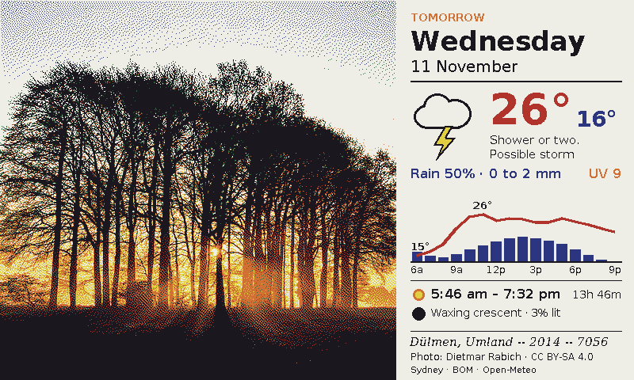

# Inky Almanac

**A calm, colourful daily poster for the Pimoroni Inky Frame 7.3".**
A new landscape photograph every day, beside the day's weather, with hazard
warnings for your area when there are any. It refreshes once an hour and stays
still the rest of the time, which suits a 7-colour e-ink panel that takes 40
seconds to redraw.



*An evening poster. After 18:00 the poster describes tomorrow, so the last
refresh of the night still helps at breakfast. Images in this README use
estimated ink colours.*

---

## What's on it

**A photograph worth looking at.** Each day the frame shows a *Featured
Picture* from Wikimedia Commons, chosen from mountains, glaciers, forests,
lakes, waterfalls and volcanoes. Every candidate is checked for colour and
contrast first, because misty or grey scenes turn to mud on seven inks. The
chosen photo is dithered for this panel's real ink colours, and the poster
credits the photographer and licence.

**The weather that matters today.**
- **BOM's official forecast** for your town: the high and low, the
  forecast text (*"Shower or two. Possible storm"*), and the chance and amount
  of rain.
- **An hourly strip** from 6 am to 9 pm, with a temperature line, rain-chance
  bars and a marker at the current hour.
- **UV**, sunrise and sunset, day length, and the moon phase, drawn as it
  looks from the southern hemisphere.

**Hazards, when there are any.** In the spirit of *Hazards Near Me*, badges
appear over the photo, coloured by the Australian Warning System:
- **RFS fires** within 30 km;
- **SES floods, storms and tsunami** covering your area;
- **BOM warnings** for your district;
- a **Total Fire Ban**, a fire danger rating of **High** or above, and **air
  quality** on smoky days.

On an ordinary day there are no badges at all.


*Sample warnings shown for illustration.*

**Honest about what it doesn't know.** If the forecast is more than three
hours old, the footer turns red. If a hazard feed has nothing current, a
neutral badge says so ("NO LIVE HAZARD DATA: SES"), so an outage never looks
like a quiet day. After six hours unable to reach its server, the frame
replaces the poster with an error screen.

## A day with the frame

| Time | What happens |
|---|---|
| 06:01 | First refresh of the day: today's photo and forecast. |
| Every hour on the hour (HH:01) | Refreshes, but only if something changed. The poster shows no clock time, so an unchanged forecast means no 40-second redraw. |
| 18:01 | Switches to **tomorrow**: tomorrow's date, forecast and photo. |
| 22:01 | Last refresh. The e-ink holds the picture all night without using power. |

### The buttons

| Button | Does |
|---|---|
| **A** | Refresh now. |
| **B** | A different photo for today. The status page's "Different photo" button does the same. |
| **E**, held at power-on | Safe mode: the app doesn't start, so you can connect a computer. |

Plugging the frame in, or resetting it, always redraws the poster straight away.

## How it works

```
  BOM, Open-Meteo,           ┌──────────────────────────┐   WiFi, hourly    ┌──────────────────────┐
  Wikimedia Commons,  ─────► │ renderer (Python, docker)│ ────────────────► │ Inky Frame (Pico W,  │
  RFS, SES, BOM warnings     │ layout + dithering, makes│  GET /frame.json  │ MicroPython)         │
  (fetched in the background)│ a 4-bit indexed PNG      │  GET /frame.png   │ draws the PNG as-is  │
                             └──────────────────────────┘                   └──────────────────────┘
```

The Pico W can't lay out a poster or dither a photo well, so a small server
does all of that. It fetches every feed in the background and renders an
800×480 PNG whose palette entries *are* the panel's ink numbers. The frame
downloads about 50 KB and copies the pixels straight onto the inks, with no
re-dithering. If the server goes away, the e-ink keeps showing the last
poster.

---

# Developer guide

## Repository layout

| Path | What |
|---|---|
| `server/almanac/app.py` | HTTP service, background feed refresh, render cache |
| `server/almanac/render.py` | poster layout and badges |
| `server/almanac/dither.py` | Atkinson dithering, matching colours in CIELAB against measured ink colours |
| `server/almanac/palette.py` | the seven inks: pen indices and real-world RGB |
| `server/almanac/photos.py` | Commons photo pool, daily pick, colour screen |
| `server/almanac/weather.py` | Open-Meteo forecast (hourly strip, UV, sun times) |
| `server/almanac/bom.py` | BOM town forecast (FTP product IDN11060), overlaid on Open-Meteo |
| `server/almanac/hazards.py` | RFS incidents, SES (via HazardWatch) and BOM warnings near home |
| `server/almanac/conditions.py` | fire danger and fire ban, air quality, feed caching and staleness |
| `server/almanac/schedule.py` | when the frame wakes, and which day the poster describes |
| `server/almanac/usbpush.py` | USB mode: the server drives a frame over the serial cable |
| `frame/almanac_frame.py` | the frame app: WiFi, fetch, draw, sleep, buttons, OTA install |
| `frame/main.py` | boot guard; never updated over the air |
| `frame/config.py` | `MODE` (`wifi`/`usb`) and `SERVER` |
| `scripts/` | deploy the server, deploy the frame, sign OTA releases |

## Setup

```bash
mise install                                   # Python, mpremote and pytest (see mise.toml)
cp frame/config.py.example frame/config.py     # then set SERVER
cp deploy.env.example deploy.env               # then set HOST, BIND, ...
scripts/sign_ota.py --new-key ~/.config/inky-almanac/ota-key.txt   # once, for OTA
```

Server tests run in docker, because rendering needs the DejaVu fonts that ship
in the image:

```bash
docker build -f server/Dockerfile.test -t inky-almanac-test server && docker run --rm inky-almanac-test
```

Frame tests run under CPython, with the Pico's modules stubbed:

```bash
mise run frame-test
```

Every behaviour fix in this repo comes with a test that was seen to fail
without the fix. Keep it that way: write the test, revert the fix, watch it
fail, restore.

## Previewing posters

The renderer's status page, `http://<renderer>:8077/`, shows the current
poster, the photo, the conditions, and when the frame last checked in.

- `/preview.png` is the poster in estimated ink colours.
- Add `?at=2026-11-10T19:30` to render any moment, for example to check the
  evening view.
- `/frame.png` is what the frame actually downloads, an indexed PNG.

## Deploying

| What changed | Run |
|---|---|
| Server code, or the frame app (`almanac_frame.py`) | `scripts/deploy-server.sh`. Runs the tests, rebuilds and restarts the container. It also signs `almanac_frame.py`, which the frame installs over the air after its next refresh. |
| `main.py`, `config.py`, WiFi or OTA key | `scripts/deploy-frame.sh --local --reset` with the frame on this machine's USB. |

Any `mpremote` command stops the app on the frame, so always finish with a
reset (`--reset`).

## Configuration

Set these as environment variables on the container; the defaults live in
`server/almanac/config.py`.

| Variable | Default |
|---|---|
| `ALMANAC_PLACE`, `ALMANAC_LAT`, `ALMANAC_LON`, `ALMANAC_TZ` | Sydney, -33.87, 151.21, Australia/Sydney |
| `ALMANAC_FIRST_HOUR`, `ALMANAC_LAST_HOUR` | 6, 22 (refresh window, inclusive) |
| `ALMANAC_TOMORROW_FROM` | 18 |
| `ALMANAC_BOM_TOWN` | Sydney (a town name from BOM's IDN11060 forecast product) |
| `ALMANAC_HAZARD_RADIUS_KM` | 30 |
| `ALMANAC_BOM_AREAS`, `ALMANAC_BOM_IGNORE` | which BOM warning titles count (comma separated) |
| `ALMANAC_FIRE_DISTRICT` | Greater Sydney Region (empty turns the fire badge off) |
| `ALMANAC_USB_DEVICE` | empty (USB mode off) |

The photo categories are `CATEGORIES` in `photos.py`. The pool refreshes every
14 days; to force a refresh, delete `photo-pool.json` from the cache volume.

## Adding a data source or a badge

1. Fetch it through `conditions._cached(...)`. Give it a `check=` that
   rejects junk, so a bad response never replaces a good cache, and a
   `stale_after=` that suits how fast it changes.
2. Have `refresh_feeds()` in `app.py` fetch it. Requests never touch the
   network; they read the caches only.
3. Parse each item on its own, so one bad item can't hide the rest.
4. Add a badge in `render.badges_for`. Use the inks that mean something
   (`palette.py`), and keep the text free of numbers that drift. Every change
   to the picture costs a 40-second refresh.

## Design choices worth knowing

- **Palette indices are inks.** The frame decodes with `pngdec.PNG_COPY`,
  so the server owns all the colour decisions.
- **No clock on the poster.** An hourly timestamp would force a full
  refresh every hour for nothing. Stale data is flagged instead.
- **Evenings describe tomorrow.** Its photo and its forecast.
- **Hazard data goes stale after 90 minutes.** An old "Advice" may have
  become an Emergency, or been cleared.
- **BOM's daily numbers come from its public FTP product.** The undocumented
  JSON API is not used, because its responses say "You must not use, copy or
  share it".

## Over-the-air updates

After one USB install (the boot guard plus the signing key), frame code
updates over WiFi:

1. `deploy-server.sh` signs `frame/almanac_frame.py`, refusing uncommitted
   code. The signature is HMAC-SHA256 over the name, version, sha256 and
   size.
2. The renderer advertises the release in `/frame.json`.
3. After a refresh that drew, the frame checks that the release is newer
   than what it runs and that the signature, size and sha256 all match. It
   records a trial, keeps the old file as `.prev`, and reboots.
4. The new version stays on trial until it draws a poster. `main.py` restores
   `.prev` if the new version won't import, or doesn't draw within 3 boots or
   30 minutes. A version that won't import, or fails two trials, is never
   retried.

The **signing key** lives on the machine you deploy from (`OTA_KEY_FILE` in
`deploy.env`), in your password manager, and on the frame (`OTA_KEY.py`,
installed with `deploy-frame.sh --local --ota-key`). It is never on the renderer, which can serve releases but can't
forge one. Only `almanac_frame.py` updates over the air; `main.py`, `config.py`
and the WiFi details change only over USB. The board records its update state
in `/ota.json`.

## USB mode (plan B)

If the frame's WiFi can't reach the server:
1. Set `MODE = "usb"` in `frame/config.py`, and redeploy the frame.
2. Run `scripts/deploy-server.sh --usb`.

The container then pushes each new poster down the USB cable. The buttons do
nothing in this mode.

---

# Operations

## Network

The frame needs to reach the renderer's port 8077 over WiFi; nothing needs to
reach the frame. If the frame lives on an isolated IoT network, allow just
that: the frame's address to the renderer's address, TCP 8077. Give the frame
a DHCP reservation, point `SERVER` in `frame/config.py` at the renderer's IP
(an IP is more robust than a name for a device like this), and publish the
container on that address only (`BIND` in `deploy.env`).

## Credentials and local settings

None are in this repo. Your own values live in gitignored files, each with an
`.example` next to it:

| File | Holds |
|---|---|
| `frame/config.py` | `MODE`, `SERVER` |
| `deploy.env` | renderer host, published address, the frame's serial device, `OTA_KEY_FILE` |
| `WIFI_CONFIG.py` (on the board only) | `SSID`, `PSK`, `COUNTRY` (see `frame/WIFI_CONFIG.example.py`) |
| `OTA_KEY.py` (on the board only) | the over-the-air signing key |

Keep the OTA key file at 0600 and a copy in your password manager. Before the
first install, back up the board's stock filesystem (it holds the WiFi details
Pimoroni's firmware was set up with): `mpremote fs cp -r :. ./stock-fs`.

## Recovery

**The app misbehaves.** Hold **E** while plugging in (safe mode), or connect
with `mpremote`, which stops the app. Fix the files, then reset.

**Reflash MicroPython.** The firmware is Pimoroni's Inky Frame build for the
Pico W: `pico_w_inky-v1.29.0-micropython.uf2` from
<https://github.com/pimoroni/inky-frame/releases/tag/v1.29.0>
(sha256 `23f96c51c899dcfd2ef5f40845596763893bf8bc136fde1ebc92285f51ea6855`).

1. Enter the bootloader: `mpremote exec "import machine; machine.bootloader()"`,
   or hold **BOOTSEL** on the Pico W (on the back) while plugging in.
2. Copy the `.uf2` onto the `RPI-RP2` drive that appears. If the filesystem is
   corrupt, flash Raspberry Pi's `flash_nuke.uf2` first.
3. Reinstall:
   ```bash
   scripts/deploy-frame.sh --local --clean-stock --wifi-config PATH/TO/WIFI_CONFIG.py --ota-key "$OTA_KEY_FILE" --reset
   ```

**Back to stock.** Copy your `stock-fs` backup back with `mpremote fs cp -r`.

**Remove the server.** On the renderer's host:
```bash
docker rm -f inky-almanac; docker rmi inky-almanac:dev; docker volume rm inky-almanac-cache; rm -rf ~/inky-almanac ~/inky-venv
```

## Known limits

- The SES source reads HazardWatch's page, since SES publishes no open API.
  If the page changes, the poster says so. For a sanctioned feed, SES asks
  you to email its warnings team: warnings.capability@ses.nsw.gov.au.
- Battery operation (power-off between refreshes, RTC wake) is written for
  but not yet proven on this board; it has run on USB.
- Keep the poster and the status page private. BOM's data is licensed for
  personal use, and SES wants its warnings republished in full.

## Credits

Photos: Wikimedia Commons Featured Pictures, each under its own licence and
credited on the poster. Weather: the Bureau of Meteorology's public forecast
and warning products, and [Open-Meteo](https://open-meteo.com) (CC BY 4.0).
Hazards: NSW RFS, and NSW SES via HazardWatch. Badges summarise; read the full
warning in Hazards Near Me or on the BOM website. Fonts: DejaVu.
