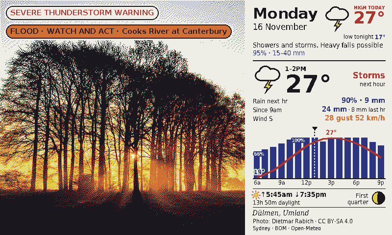

# Inky Almanac

**A calm, colourful daily poster for the Pimoroni Inky Frame 7.3".**
A new landscape photograph every day, beside the day's weather, with hazard
warnings for your area when there are any. It refreshes once an hour and stays
still the rest of the time, which suits a 7-colour e-ink panel that takes 40
seconds to redraw.


*An evening poster. After 18:00 the poster describes tomorrow, so the last
refresh of the night still helps at breakfast. Images in this README use
estimated ink colours.*

---

## What's on it

**A photograph worth looking at.** Each day the frame shows a *Featured
Picture* from Wikimedia Commons, chosen from mountains, glaciers, forests,
lakes, waterfalls and volcanoes. Every candidate is checked for colour and
contrast first, because misty or grey scenes turn to mud on seven inks. The
chosen photo is dithered for this panel's real ink colours, and the poster
credits the photographer and licence.

**The weather that matters today.**
- **BOM's official forecast** for your town: the forecast text (*"Shower or
  two. Possible storm"*) and one pair of extremes, led by whichever comes
  next: the overnight low before 9 am, today's high until 6 pm, then
  tonight's low. After the forecast text comes the day's chance of rain and
  BOM's rain range ("80% · 2–8 mm"), in blue from 30%.
- **The coming hour**, large: its sky, its temperature, and the most unusual
  thing about it, with up to four more facts underneath. Facts are ranked by
  how far out of the ordinary they are: hail and storms first, then heavy
  rain, rain since 9 am, a wind change, strong wind, UV above normal, and a
  high well off normal. A quiet hour says "nothing unusual".
- **What has actually happened.** Rain since 9 am and in the last hour come
  from a nearby BOM weather station's rain gauge (Horsley Park by default),
  not a model. A southerly change seen at a coastal station but not yet at
  home becomes a strong "Southerly change arriving" fact. The station is
  named on the poster's credit line.
- **An hourly strip** from 6 am to 9 pm, with a temperature line, rain-chance
  bars and a marker at the current hour. It takes whatever height is left.
- Sunrise and sunset, day length, and the moon phase, drawn as it looks
  from the southern hemisphere.


**Hazards, when there are any.** In the spirit of *Hazards Near Me*, badges
appear over the photo, coloured by the Australian Warning System:
- **RFS fires** within 30 km;
- **SES floods, storms and tsunami** covering your area;
- **BOM warnings** for your district;
- a **Total Fire Ban**, a fire danger rating of **High** or above, and **air
  quality** on smoky days.

On an ordinary day there are no badges at all.



*Sample warnings shown for illustration.*

**Honest about what it doesn't know.** If the forecast is more than three
hours old, the footer turns red. If a hazard feed has nothing current, a
neutral badge says so ("NO LIVE HAZARD DATA: SES"), so an outage never looks
like a quiet day. After six hours unable to reach its server, the frame
replaces the poster with an error screen.

## A day with the frame

| Time | What happens |
|---|---|
| 06:01 | First refresh of the day: today's photo and forecast. |
| Every hour on the hour (HH:01) | Refreshes, but only if something changed. The poster shows no clock time, so an unchanged forecast means no 40-second redraw. |
| 18:01 | Switches to **tomorrow**: tomorrow's date, forecast and photo. |
| 22:01 | Last refresh. The e-ink holds the picture all night without using power. |

### The buttons

| Button | Does |
|---|---|
| **A** | Refresh now. |
| **B** | A different photo for today. The status page's "Different photo" button does the same. |
| **E**, held at power-on | Safe mode: the app doesn't start, so you can connect a computer. |

Plugging the frame in, or resetting it, always redraws the poster straight away.

## How it works

```
  BOM, Open-Meteo,           ┌──────────────────────────┐   WiFi, hourly    ┌──────────────────────┐
  Wikimedia Commons,  ─────► │ renderer (Python, docker)│ ────────────────► │ Inky Frame (Pico W,  │
  RFS, SES, BOM warnings     │ layout + dithering, makes│  GET /frame.json  │ MicroPython)         │
  (fetched in the background)│ a 4-bit indexed PNG      │  GET /frame.png   │ draws the PNG as-is  │
                             └──────────────────────────┘                   └──────────────────────┘
```

The Pico W can't lay out a poster or dither a photo well, so a small server
does all of that. It fetches every feed in the background and renders an
800×480 PNG whose palette entries *are* the panel's ink numbers. The frame
downloads about 50 KB and copies the pixels straight onto the inks, with no
re-dithering. If the server goes away, the e-ink keeps showing the last
poster.

---

# Developer guide

## Repository layout

| Path | What |
|---|---|
| `server/almanac/app.py` | HTTP service, background feed refresh, render cache |
| `server/almanac/render.py` | poster layout and badges |
| `server/almanac/dither.py` | Atkinson dithering, matching colours in CIELAB against measured ink colours |
| `server/almanac/palette.py` | the seven inks: pen indices and real-world RGB |
| `server/almanac/domain.py` | the plain data every provider produces: `Forecast`, `Day`, `Hour`, `DayOutlook`, `Reading`, `StationLogs`, `MapImage`, `FireDanger`, `AirQualityHour`, `Photo` |
| `server/almanac/hazards.py` | the `Hazard` type, its ranking and identity, and distance from home |
| `server/almanac/facts.py` | the coming hour's facts and their scores (pure) |
| `server/almanac/anchor.py` | anchors the model's hourly temperatures to the official outlook's max and min (pure) |
| `server/almanac/observed.py` | rain since 9 am and in the last hour, and southerly changes, from station logs (pure) |
| `server/almanac/normals.py` | the `Normals` interface the fact scorer reads; defaults to the configured normals provider |
| `server/almanac/conditions.py` | gathers fire danger, air quality, hazards and the warning map into one `Conditions` |
| `server/almanac/providers/` | every external source, one adapter module each (see "Adding or swapping a provider") |
| `server/almanac/data/uv_normals.json` | hourly UV normals for Sydney, built by `tools/build_uv_normals.py` |
| `server/almanac/schedule.py` | when the frame wakes, and which day the poster describes |
| `server/almanac/usbpush.py` | USB mode: the server drives a frame over the serial cable |
| `frame/almanac_frame.py` | the frame app: WiFi, fetch, draw, sleep, buttons, OTA install |
| `frame/main.py` | boot guard; never updated over the air |
| `frame/config.py` | `MODE` (`wifi`/`usb`) and `SERVER` |
| `scripts/` | deploy the server, deploy the frame, sign OTA releases |
| `tools/` | one-off data builds (the UV normals table) |

## Setup

```bash
mise install                                   # Python, mpremote and pytest (see mise.toml)
cp frame/config.py.example frame/config.py     # then set SERVER
cp deploy.env.example deploy.env               # then set HOST, BIND, ...
cp server.env.example server.env               # your location (ALMANAC_* settings)
scripts/sign_ota.py --new-key ~/.config/inky-almanac/ota-key.txt   # once, for OTA
```

Server tests run in docker, because rendering needs the DejaVu fonts that ship
in the image:

```bash
docker build -f server/Dockerfile.test -t inky-almanac-test server && docker run --rm inky-almanac-test
```

Frame tests run under CPython, with the Pico's modules stubbed:

```bash
mise run frame-test
```

Every behaviour fix in this repo comes with a test that was seen to fail
without the fix. Keep it that way: write the test, revert the fix, watch it
fail, restore.

## Previewing posters

The side panel's layout stills in `docs/img/panel-*.png` (worst cases in
photo and map mode, a normal day, a quiet morning, an evening) come from the
test fixtures. Regenerate them rather than edit them:

```bash
docker run --rm -v "$PWD/server:/app" -v "$PWD/docs/img:/out" inky-almanac-test python tests/render_stills.py /out
```

The renderer's status page, `http://<renderer>:8077/`, shows the current
poster, the photo, the conditions, and when the frame last checked in.

- `/preview.png` is the poster in estimated ink colours.
- Add `?at=2026-11-10T19:30` to render any moment, for example to check the
  evening view.
- `/frame.png` is what the frame actually downloads, an indexed PNG.

## Deploying

| What changed | Run |
|---|---|
| Server code, or the frame app (`almanac_frame.py`) | `scripts/deploy-server.sh`. Runs the tests, rebuilds and restarts the container. It also signs `almanac_frame.py`, which the frame installs over the air after its next refresh. |
| `main.py`, `config.py`, WiFi or OTA key | `scripts/deploy-frame.sh --local --reset` with the frame on this machine's USB. |

Any `mpremote` command stops the app on the frame, so always finish with a
reset (`--reset`).

## Configuration

Set these in `server.env` (gitignored; `deploy-server.sh` passes it to the
container). The defaults live in `server/almanac/config.py`.

| Variable | Default |
|---|---|
| `ALMANAC_PLACE`, `ALMANAC_LAT`, `ALMANAC_LON`, `ALMANAC_TZ` | Sydney, -33.87, 151.21, Australia/Sydney |
| `ALMANAC_FIRST_HOUR`, `ALMANAC_LAST_HOUR` | 6, 22 (refresh window, inclusive) |
| `ALMANAC_TOMORROW_FROM` | 18 |
| `ALMANAC_HIGH_LEADS_FROM` | 9 (before this hour the header leads with the overnight low) |
| `ALMANAC_BOM_TOWN` | Sydney (a town name from BOM's IDN11060 forecast product) |
| `ALMANAC_HAZARD_RADIUS_KM` | 30 |
| `ALMANAC_BOM_AREAS`, `ALMANAC_BOM_IGNORE` | which BOM warning titles count (comma separated) |
| `ALMANAC_FIRE_DISTRICT` | Greater Sydney Region (empty turns the fire badge off) |
| `ALMANAC_USB_DEVICE` | empty (USB mode off) |
| `ALMANAC_FORECAST`, `ALMANAC_OUTLOOK`, `ALMANAC_OBSERVATIONS` | openmeteo, bom, bom (which provider supplies each kind of data; `none` turns a kind off) |
| `ALMANAC_HAZARDS` | rfs,hazardwatch,bom |
| `ALMANAC_WARNING_MAPS`, `ALMANAC_FIRE_DANGER`, `ALMANAC_AIR_QUALITY`, `ALMANAC_PHOTOS`, `ALMANAC_NORMALS` | bom, rfs, openmeteo, commons, era5 (`placeholder` for a fixed table) |
| `ALMANAC_OBS_STATION` | 94760 (Horsley Park AWS; a WMO id from BOM's state observations product) |
| `ALMANAC_OBS_CROSSCHECK` | 95765,94765 (Sydney Olympic Park, Bankstown: stand in when the home station is silent) |
| `ALMANAC_OBS_LEADING` | 95756,94767,94769,94768 (Kurnell, Sydney Airport, Fort Denison, Observatory Hill: where a southerly arrives first) |
| `ALMANAC_OBS_PRODUCT` | IDN60920 (BOM's NSW 10-minute observations; other states have their own) |

The photo categories are `CATEGORIES` in `providers/commons.py`. The pool refreshes every
14 days; to force a refresh, delete `photo-pool.json` from the cache volume.

## Adding or swapping a provider

Every external source sits behind an adapter in `server/almanac/providers/`,
one module per source. The scorer, the layout and the scheduler only ever see
plain domain data (`domain.py`, `hazards.Hazard`), so a fork for another
state or country replaces adapters and leaves the rest alone.

| Kind | Interface (`providers/base.py`) | Shipped adapters | Setting |
|---|---|---|---|
| forecast | `ForecastProvider.forecast()` → `Forecast` | `openmeteo` | `ALMANAC_FORECAST` |
| official daily outlook | `OutlookProvider.outlook()` → `{date: DayOutlook}` | `bom` (IDN11060 town forecasts) | `ALMANAC_OUTLOOK` |
| station observations | `ObservationsProvider.refresh()`, `.logs()` → `StationLogs` | `bom` (state 10-minute observations) | `ALMANAC_OBSERVATIONS` |
| hazards | `HazardProvider.hazards()` → `[Hazard]` or None | `rfs`, `hazardwatch`, `bom` | `ALMANAC_HAZARDS` (several) |
| warning maps | `WarningMapProvider.warning_map()` → `MapImage` | `bom` | `ALMANAC_WARNING_MAPS` |
| fire danger | `FireDangerProvider.fire_danger()` → `FireDanger` | `rfs` | `ALMANAC_FIRE_DANGER` |
| air quality | `AirQualityProvider.air_quality()` → `[AirQualityHour]` | `openmeteo` | `ALMANAC_AIR_QUALITY` |
| photos | `PhotoProvider.photo_for()` → `Photo` | `commons` | `ALMANAC_PHOTOS` |
| climate normals | `normals.Normals` (`normal_max`, `normal_uv`) | `era5` (+ ARPANSA UV), `placeholder` | `ALMANAC_NORMALS` |

Sun and moon are not providers: sunrise and sunset arrive with the forecast,
and the moon phase is computed locally (`astro.py`).

To add one:

1. Write `providers/<source>.py` with a class constructed as
   `Adapter(cfg, get_text=None)` that satisfies the interface. Turn the
   source's format into domain types there and nowhere else: units as
   `domain.py` says (°C, km/h, mm, degrees the wind blows from), weather as
   WMO codes, a short `source` credit for the poster.
2. Fetch through `get_text(url)` and `providers.cache.cached(...)`. Give it a
   `check=` that rejects junk, so a bad response never replaces a good cache,
   and a `stale_after=` that suits how fast the source changes. On the
   request path `get_text` is `cache.offline`, so requests only ever read
   caches; the background refresher in `app.py` does the fetching.
3. Parse each item on its own, so one bad item can't hide the rest, and
   return None or empty rather than raise when the source is down.
4. Register it in `REGISTRY` in `providers/__init__.py` and select it with
   the setting. Test it against a recorded fixture: no network in tests.

`tests/test_boundaries.py` fails if a module outside `providers/` imports a
concrete adapter (only `app.py` composes, through the registry), or carries a
provider's name or field names in its code.

Known coupling left: the warning map's ink table (`dither.map_ink`) is tuned
to BOM's map colours; a map provider with a different palette would want its
own table or to deliver ink-ready images.

To add a badge, add it in `render.badges_for`. Use the inks that mean
something (`palette.py`), and keep the text free of numbers that drift. Every
change to the picture costs a 40-second refresh.

## Which source wins

Where more than one source gives a figure, the poster uses the most
authoritative one that has it:

| Rank | Source | Figures it supplies |
|---|---|---|
| 1 | Observed: the BOM station (Horsley Park AWS by default) | rain since 9 am and in the last hour; the coming hour's temperature, from a reading under 30 minutes old; a southerly change it has seen |
| 2 | BOM forecast: the town précis (IDN11060) | the day's max and min, forecast text, icon and chance of rain |
| 3 | Model: Open-Meteo | everything hourly (temperature curve, rain-chance bars, wind, UV), sun times, and any daily figure BOM leaves out |

The model's hourly temperatures are anchored to BOM's figures
(`anchor.py`), so the chart, the coming hour and the "vs normal" fact agree
with the header. The model's peak between 6 am and 9 pm becomes BOM's max
and its trough between midnight and 9 am becomes BOM's min; temperatures in
between map linearly, so the curve keeps the model's timing. With only one
of BOM's figures (BOM drops today's min after the morning), the curve shifts
to match that one. The rain-chance bars stay the model's, because BOM
publishes no free hourly product. The day's rain on the forecast line
("· 80% · 2–8 mm") is BOM's chance of any rain and its range; with no BOM
outlook the line shows no rain figure rather than the model's.

The poster labels none of this: an observed temperature and a forecast one
look the same.

## Station observations

The `bom` observations adapter reads BOM's state 10-minute observations
product over anonymous FTP (`ftp://ftp.bom.gov.au/anon/gen/fwo/IDN60920.xml`
for NSW: every station, latest observation only, about 540 KB). It fetches
at most every 10 minutes, the product's own cadence, backs off (20 minutes,
doubling, at most an hour) when the fetch fails, and keeps a three-hour
rolling log of the configured stations in the cache volume
(`bom-obs-log.json`). Requests read the log only, so rendering never waits
for FTP. Elements are read by their `type` attribute; any of them may be
missing (Fort Denison and Kurnell report wind only).

`observed.py` turns the log into facts, with named constants for every rule:

- A reading older than 30 minutes counts as missing, and the facts fall back
  to the forecast's modelled rain. When the home station is silent, the first
  cross-check station with a fresh reading stands in.
- **Since 9 am** is the gauge's own figure. **Last hour** differences two
  cumulative readings an hour apart (within 10 minutes); across the 9 am reset
  it adds what fell before 9 from the previous period's closing total. A gap
  in the log makes it unknown rather than guessed.
- **A southerly change** at a station: the wind has swung into SE-S-SW (at
  least 45°, at 10 km/h or more) within the last hour, and the temperature
  fell 2° or more or the gust rose 15 km/h or more. A swing alone doesn't
  count. Seen at a leading (coastal) station but not at home, it is a strong
  "Southerly change arriving" fact (score 80, re-checked every 15 minutes),
  and it replaces a forecast southerly change; seen at home it is "Southerly
  change: arrived".

BOM's anonymous FTP products are for personal, non-commercial use (see BOM's
copyright notice). The renderer doesn't use `api.weather.bom.gov.au` (its
responses forbid reuse) and doesn't scrape bom.gov.au pages. Station IDs are
WMO numbers; find others in the product itself (`<station wmo-id=…
description=…>`).

## Climate normals

`providers/climate.py` answers "what does this hour usually look like here?", for
facts like "4° warmer than a normal November 3 pm". Every cell is a
(month, hour) of local clock time, daylight saving included.

```python
from almanac.providers.climate import NORMALS
NORMALS.temp(11, 15)            # TempNormal(mean, std, p10, p50, p90)
NORMALS.daily_max(1)            # normal daily maximum
NORMALS.wind(9, 14)             # WindNormal(p50, p90, gust_p50, gust_p90, sectors)
NORMALS.rain(2, 16)             # RainNormal(p_wet, wet_mean, wet_p90)
NORMALS.uv(1, 13)               # UVNormal(mean, p90)
NORMALS.southerly_rate(12, 17)  # chance of a southerly change in that hour
NORMALS.temp_percentile(11, 15, 31.0)
NORMALS.normal_max(month, hour=None), NORMALS.normal_uv(month, hour=None)  # the fact scorer's calls
```

- **Temperature, wind and rain** are computed at runtime from Open-Meteo's
  ERA5 archive (`era5_seamless`, 1991-2020) at `ALMANAC_LAT`/`ALMANAC_LON`.
  The renderer pulls 30 yearly chunks in the background on first start (about
  2.5 minutes, 30 requests), writes `climate-normals.json` to the cache volume,
  and rebuilds it once a year or when the location changes. Until then, or if
  a build fails (it retries every 6 hours, resuming from the years it already
  has), a rough central-Sydney placeholder answers. Nothing is committed,
  because the location is private.
- **Rain**: an hour is wet from 0.1 mm, because ERA5 drizzles far too often.
  `p_wet` is the chance of a wet hour; `wet_mean` and `wet_p90` are over wet
  hours only.
- **Southerly changes** are a reanalysis proxy: the wind swings from N, NE,
  NW or W to S, SE or SW between two consecutive hours and blows at least
  20 km/h afterwards. A 25 km grid smooths real changes, which often take
  more than an hour to swing or arrive between grid points, so this
  under-counts them badly (about 0.2-0.9 a month at Observatory Hill) and
  mistimes them. Treat it as relative, month against month.
- **Daily max/min** are from hourly values, so they sit a little inside a
  thermometer's true extremes.
- **UV** is ARPANSA's measured 1-minute UV index for Sydney, 2007-2025,
  averaged to hourly means (`uv(month, hour)`), plus each day's peak reading
  (`uv_peak(month)`, which is what `normal_uv(month)` returns). It describes
  a public site, so the table is committed; rebuild it with
  `tools/build_uv_normals.py` (about 400 MB of downloads, cached under
  `cache/`). UV observations courtesy of ARPANSA.

## Design choices worth knowing

The full reasoning behind the panel, the scoring, the refresh tiers and the
data sources is in [docs/design.md](docs/design.md). Read it before changing
any of them.

- **Palette indices are inks.** The frame decodes with `pngdec.PNG_COPY`,
  so the server owns all the colour decisions.
- **No clock on the poster.** An hourly timestamp would force a full
  refresh every hour for nothing. Stale data is flagged instead.
- **Evenings describe tomorrow.** Its photo and its forecast.
- **A remarkable coming hour is re-checked between refreshes.** The top
  fact's score sets a tier: 90+ every 10 minutes (the frame's own cap on
  alert redraws), 75+ every 15, 50+ every 30, otherwise hourly. A re-check
  redraws only when the facts shown differ enough from the ones last drawn:
  a fact appears or goes, the leading fact changes kind, or a score rises by
  more than 5 or falls by more than 10. A few mm or km/h either way waits for
  the hourly refresh. Between re-checks the answer is held, so a fact that
  vanishes mid-interval can't flash the panel. While a tier is active the
  forecast is fetched as often as the tier re-checks.
- **"Since 9am" is measured when it can be.** It comes from the BOM station's
  rain gauge (see "Station observations"); only when the station has no fresh
  reading does it fall back to summing the model's hourly precipitation.
- **Hazard data goes stale after 90 minutes.** An old "Advice" may have
  become an Emergency, or been cleared.
- **BOM's daily numbers come from its public FTP product.** The undocumented
  JSON API is not used, because its responses say "You must not use, copy or
  share it".

## Over-the-air updates

After one USB install (the boot guard plus the signing key), frame code
updates over WiFi:

1. `deploy-server.sh` signs `frame/almanac_frame.py`, refusing uncommitted
   code. The signature is HMAC-SHA256 over the name, version, sha256 and
   size.
2. The renderer advertises the release in `/frame.json`.
3. After a refresh that drew, the frame checks that the release is newer
   than what it runs and that the signature, size and sha256 all match. It
   records a trial, keeps the old file as `.prev`, and reboots.
4. The new version stays on trial until it draws a poster. `main.py` restores
   `.prev` if the new version won't import, or doesn't draw within 3 boots or
   30 minutes. A version that won't import, or fails two trials, is never
   retried.

The **signing key** lives on the machine you deploy from (`OTA_KEY_FILE` in
`deploy.env`), in your password manager, and on the frame (`OTA_KEY.py`,
installed with `deploy-frame.sh --local --ota-key`). It is never on the renderer, which can serve releases but can't
forge one. Only `almanac_frame.py` updates over the air; `main.py`, `config.py`
and the WiFi details change only over USB. The board records its update state
in `/ota.json`.

## USB mode (plan B)

If the frame's WiFi can't reach the server:
1. Set `MODE = "usb"` in `frame/config.py`, and redeploy the frame.
2. Run `scripts/deploy-server.sh --usb`.

The container then pushes each new poster down the USB cable. The buttons do
nothing in this mode.

---

# Operations

## Network

The frame needs to reach the renderer's port 8077 over WiFi; nothing needs to
reach the frame. If the frame lives on an isolated IoT network, allow just
that: the frame's address to the renderer's address, TCP 8077. Give the frame
a DHCP reservation, point `SERVER` in `frame/config.py` at the renderer's IP
(an IP is more robust than a name for a device like this), and publish the
container on that address only (`BIND` in `deploy.env`).

## Credentials and local settings

None are in this repo. Your own values live in gitignored files, each with an
`.example` next to it:

| File | Holds |
|---|---|
| `frame/config.py` | `MODE`, `SERVER` |
| `deploy.env` | renderer host, published address, the frame's serial device, `OTA_KEY_FILE` |
| `server.env` | your location and other `ALMANAC_*` settings for the renderer |
| `WIFI_CONFIG.py` (on the board only) | `SSID`, `PSK`, `COUNTRY` (see `frame/WIFI_CONFIG.example.py`) |
| `OTA_KEY.py` (on the board only) | the over-the-air signing key |

Keep the OTA key file at 0600 and a copy in your password manager. Before the
first install, back up the board's stock filesystem (it holds the WiFi details
Pimoroni's firmware was set up with): `mpremote fs cp -r :. ./stock-fs`.

## Recovery

**The app misbehaves.** Hold **E** while plugging in (safe mode), or connect
with `mpremote`, which stops the app. Fix the files, then reset.

**Reflash MicroPython.** The firmware is Pimoroni's Inky Frame build for the
Pico W: `pico_w_inky-v1.29.0-micropython.uf2` from
<https://github.com/pimoroni/inky-frame/releases/tag/v1.29.0>
(sha256 `23f96c51c899dcfd2ef5f40845596763893bf8bc136fde1ebc92285f51ea6855`).

1. Enter the bootloader: `mpremote exec "import machine; machine.bootloader()"`,
   or hold **BOOTSEL** on the Pico W (on the back) while plugging in.
2. Copy the `.uf2` onto the `RPI-RP2` drive that appears. If the filesystem is
   corrupt, flash Raspberry Pi's `flash_nuke.uf2` first.
3. Reinstall:
   ```bash
   scripts/deploy-frame.sh --local --clean-stock --wifi-config PATH/TO/WIFI_CONFIG.py --ota-key "$OTA_KEY_FILE" --reset
   ```

**Back to stock.** Copy your `stock-fs` backup back with `mpremote fs cp -r`.

**Remove the server.** On the renderer's host:
```bash
docker rm -f inky-almanac; docker rmi inky-almanac:dev; docker volume rm inky-almanac-cache; rm -rf ~/inky-almanac ~/inky-venv
```

## Known limits

- The SES source reads HazardWatch's page, since SES publishes no open API.
  If the page changes, the poster says so. For a sanctioned feed, SES asks
  you to email its warnings team: warnings.capability@ses.nsw.gov.au.
- Battery operation (power-off between refreshes, RTC wake) is written for
  but not yet proven on this board; it has run on USB.
- Keep the poster and the status page private. BOM's data, including the
  anonymous FTP observations, is licensed for personal, non-commercial use,
  and SES wants its warnings republished in full.

## Credits

Photos: Wikimedia Commons Featured Pictures, each under its own licence and
credited on the poster. Weather: the Bureau of Meteorology's public forecast,
warning and station observation products (the observing station, Horsley
Park AWS by default, is named on the poster), and [Open-Meteo](https://open-meteo.com) (CC BY 4.0), including its ERA5
reanalysis archive for the climate normals. UV observations courtesy of
ARPANSA (CC BY 2.5 AU).
Hazards: NSW RFS, and NSW SES via HazardWatch. Badges summarise; read the full
warning in Hazards Near Me or on the BOM website. Fonts: DejaVu.
