# What the poster does, and why

A guide for living with the frame. It explains every small behaviour you
might notice and the reason behind it. (Developers: the same decisions, with
the code references, are in [design.md](design.md).)

Images here are drawn by the real renderer from test fixtures for central
Sydney, in estimated ink colours.

## When it redraws

A full redraw takes the panel about 40 seconds and is visible, so redraws
are rationed. The poster has **no clock** on it for the same reason: a clock
would force a redraw every hour for nothing.

- **Every hour, at a minute past**, from 6:01 am to 10:01 pm. It redraws
  only if the picture would change; overnight it sleeps, and the e-ink holds
  the last poster with no power.
- **Plugging it in or resetting it** always redraws straight away.
- **Between the hours, on USB power**, the frame asks the renderer every 2
  minutes whether anything important changed. Asking is cheap; it only
  redraws when there is something worth a redraw.
- **A remarkable coming hour is re-checked sooner.** The top fact's score
  sets the pace: hail and storms every 10 minutes; a southerly change seen
  at the coast, or a 38° day, every 15; a wind change or real rain in the
  coming hour every 30; everything else hourly. Ten minutes is the floor,
  because each redraw is slow and visible.
- **"Roughly the same" waits for the hour.** At a re-check the panel redraws
  only if a fact appeared or vanished, the leading fact changed kind, or a
  score moved a lot (up by more than 5 for worse news, down by more than 10
  for better). A few millimetres or km/h either way waits for the hourly
  redraw. It compares with what is actually on the wall, so small drifts
  can't add up unnoticed.
- **No flicker.** Once a re-check has decided, the answer holds until its
  interval ends, so a fact that comes and goes mid-interval can't flash the
  panel.

## Evenings show tomorrow

From 6 pm the forecast, the chart and the photo are tomorrow's, so the last
redraw of the night is still useful at breakfast. The date stays today's;
the forecast line starts with an orange **Tomorrow:** instead.

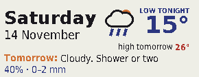

## The big number: whichever extreme comes next

Only one high/low pair is shown, top right, and the big one is where the day
is heading:

- before 9 am: the **overnight low** big and blue, today's high small;
- from 9 am to 6 pm: **HIGH TODAY** big and red, tonight's low small;
- from 6 pm: **LOW TONIGHT** big and blue, tomorrow's high small.

The 9 am switch is a setting (`ALMANAC_HIGH_LEADS_FROM`). The figures are
the Bureau of Meteorology's official forecast for the configured town, and
the hourly curve is stretched to agree with them.

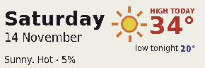

## The coming hour, and the facts under it

Below the line, large: the coming hour's sky, its temperature and the single
most unusual thing about it (the "hero" fact). Up to four more facts sit in
a table underneath. A quiet hour says "nothing unusual".

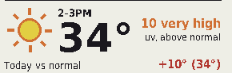

Facts are ranked by how far out of the ordinary they are:

- **Hazards always lead.** Hail beats storms, and nothing else can outrank
  either of them. "Storms later" and fog score lower, so a very hot day can
  outrank them.
- **Rain shows chance and depth together** ("60% · 0.6 mm"). A low chance
  with no depth isn't shown at all.
- **Rain since 9 am and in the last hour come from a real rain gauge**, the
  nearest BOM weather station (Horsley Park by default, named on the
  poster's bottom line). The headline is the total since 9 am, with the last
  hour small beside it. Only if the station has nothing fresh does it fall
  back to the forecast model.
- **A wind change matters more than wind.** A swing of 90° or more in the
  coming hour is a fact; plain wind needs gusts of 40 km/h or more (or a
  steady 30) to rank highly.
- **UV and the day's high are compared with normal** for this month and
  hour ("+10° (34°)" means 10° above a normal day). UV 14 at noon in
  January is ordinary; UV 7 at 5 pm in July is not.
- **The coming hour's temperature is measured when it can be**: the
  station's reading, if it is under half an hour old.

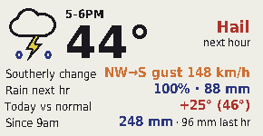

## Southerly changes: "arriving" and "arrived"

A southerly change reaches the coast before it reaches the west. The
renderer watches coastal stations (Kurnell, Sydney Airport, Fort Denison,
Observatory Hill). When one of them sees the wind swing into the south with
a temperature drop or a gust jump, and home hasn't yet, the panel says
**"Southerly change arriving · at Kurnell"** and re-checks every 15 minutes.
Once the home station sees it, it becomes **"Southerly change: arrived"**,
which is news rather than a warning, so it ranks lower.

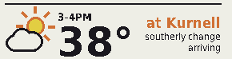

## The chart

The strip runs from 6 am to 9 pm and takes whatever height is left.

- **Rain bars are 0–100%**, not scaled to the day, so a short bar always
  means a low chance. A bar of 4% or less isn't drawn.
- **The wettest and driest hours get a % label**, only on bars that are
  drawn: white inside a tall bar, blue above a short one.
- **The temperature line** has its maximum labelled in red and its minimum
  in blue, outlined in white and drawn on top of everything.
- **The dashed line is now.** It turns white over a bar and black over
  paper, so it never hides a label's digit (it once made "34%" read "4%").
- **Labels move rather than collide**: half a bar, then a whole bar, to
  whichever side is free; a rain label is dropped only when boxed in.

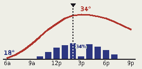

## Sun and moon

Sunrise, sunset and the length of the day, then the moon's phase by name,
drawn as it looks from the southern hemisphere: a waxing moon is lit on the
left. (The hemisphere follows the configured latitude.)

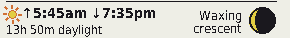

## Hazard badges

In the spirit of *Hazards Near Me*, badges appear over the photo only when
there is something to say. They come in two kinds:

- **Specific hazards** pinpoint a threat near home that asks for action: a
  severe thunderstorm, severe weather or flood warning from BOM, or an RFS
  fire or SES warning at *Watch and Act* or *Emergency Warning* within 30 km.
  These redraw the poster within minutes on USB power.
- **Broad notices** are worth knowing but not urgent: flood watches,
  region-wide BOM notices, RFS and SES *Advice*, a Total Fire Ban, a fire
  danger rating of High or above, and poor air quality. They wait for the
  hourly redraw and come after the specific ones.

Colours follow the Australian Warning System (Advice yellow, Watch and Act
orange, Emergency red); BOM's named warnings are white with red text. At
most four badges show; the last becomes "+N MORE".

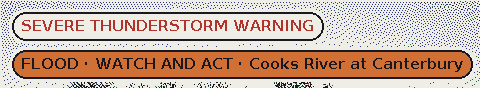

## Warning-map mode

While a specific BOM warning that comes with a map is in force (a severe
thunderstorm warning, typically), the warning's threat-area map replaces the
photo, and the text panel widens to use the space.

- **What the colours mean**: yellow is the warning area, orange the
  immediate threat, red the severe storm cells; blue is the sea; green lines
  are boundaries; town names are black.
- **The warnings in force are listed** at the bottom of the panel instead of
  as badges: the mapped warning in red with its area and issue time, other
  specific hazards as bullets, and broad notices on one "Also:" line.
- **A first warning redraws at once**, and so does the all-clear: the photo
  comes back as soon as the warning is cancelled. In between, reissues and
  moving storms redraw at most every 10 minutes.
- A map older than 10 minutes is treated as history and dropped, and a
  cancellation never shows a map.

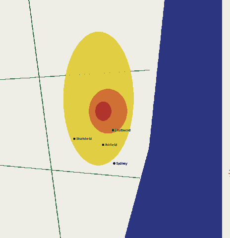
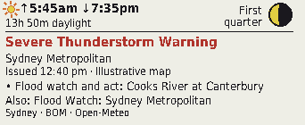

## Radar mode

Press **C** and the photo gives way to the Bureau's rain radar (Sydney,
Terrey Hills, 64 km range), with home marked by a small ring. The side panel
stays as it is, and hazard badges still sit over the radar.

- **It ends by itself** at midnight, or once it has run at least 2 hours and
  the radar shows no rain. Press **C** again to leave sooner.
- **While it rains within 64 km of home**, a USB-powered frame redraws for
  each new radar frame (about every 5 minutes). Otherwise about every 10.
- **A new warning ends it**, so the warning's map can show. A reissue of a
  warning already in force doesn't.
- **On battery** the radar shows at the usual hourly wakes; the faster
  updates need USB power.
- **The rain colours**: light rain is a pale blue stipple, thickening to
  solid blue; moderate rain is green; heavy rain is yellow, then orange, then
  red; the most extreme levels add black.

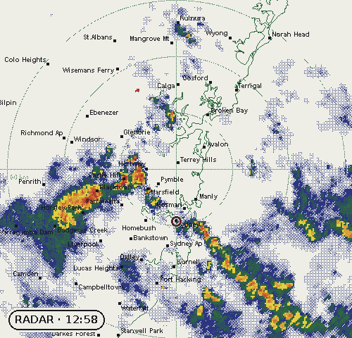

## The buttons

| Button | Does |
|---|---|
| **A** | Refresh now, even if nothing changed. |
| **B** | A different photo for the rest of today (the status page has a button for it too). |
| **C** | Radar mode on or off. |
| **E**, held while plugging in | Safe mode: the app doesn't start, so a computer can connect. |

On battery, the press that wakes the board counts. Each button's light stays
on while the frame works on that press.

## Updates, and the double flash

The frame updates its own software over Wi-Fi when a new signed version is
released. After it installs one it reboots and redraws to prove the new
version can draw, so you may see **two redraws close together**: the
normal hourly one, then the same poster again a minute later. That's
expected. If the new version can't draw, the frame goes back to the old one
by itself.

## When data is stale or missing

- If the forecast is more than 3 hours old, the bottom line turns red:
  "forecast over 3 h old" (then 12 h, then a day).
- If a hazard feed has nothing current, a neutral badge says
  "NO LIVE HAZARD DATA" with the source's name, so an outage never looks
  like a quiet day.
- If the frame can't reach its renderer for 6 hours, it replaces the poster
  with an error screen saying when it started failing. It keeps retrying;
  press A to retry at once.

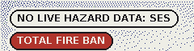
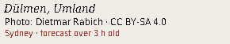

## If something goes wrong

Press A first. If the frame is stuck, unplug it and plug it back in: that
always redraws. Hold **E** while plugging in to stop the app so a computer
can connect. Recovery, reflashing and going back to stock are in
[operations.md](operations.md#recovery).
