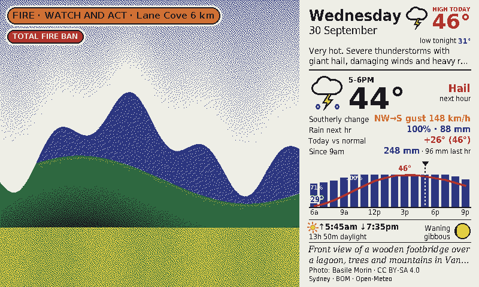
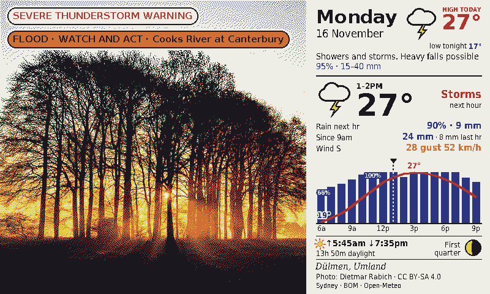
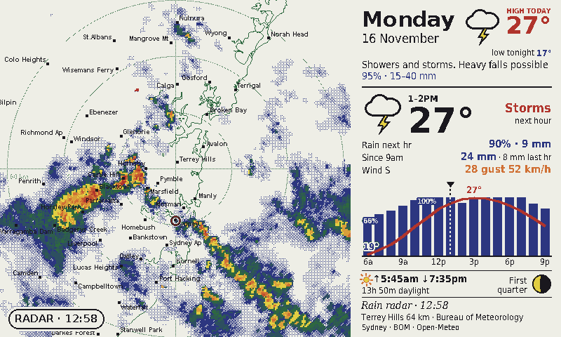

# Using the frame

What the poster shows, what a day with it looks like, and what the buttons do.
For how it works inside, see [architecture.md](architecture.md); for why it
works that way, [design.md](design.md).

## What's on it

**A photograph worth looking at.** Each day the frame shows a *Featured
Picture* from Wikimedia Commons, chosen from mountains, glaciers, forests,
lakes, waterfalls and volcanoes. Every candidate is checked for colour and
contrast first, because misty or grey scenes turn to mud on seven inks. The
chosen photo is dithered for this panel's real ink colours, and the poster
credits the photographer and licence.

**The weather that matters today.**
- **BOM's official forecast** for your town: the forecast text (*"Shower or
  two. Possible storm"*) and one pair of extremes, led by whichever comes
  next: the overnight low before 9 am, today's high until 6 pm, then
  tonight's low. After the forecast text comes the day's chance of rain and
  BOM's rain range ("80% · 2–8 mm"), in blue from 30%.
- **The coming hour**, large: its sky, its temperature, and the most unusual
  thing about it, with up to four more facts underneath. Facts are ranked by
  how far out of the ordinary they are: hail and storms first, then heavy
  rain, rain since 9 am, a wind change, strong wind, UV above normal, and a
  high well off normal. A quiet hour says "nothing unusual".
- **What has actually happened.** Rain since 9 am and in the last hour come
  from a nearby BOM weather station's rain gauge (Horsley Park by default),
  not a model. A southerly change seen at a coastal station but not yet at
  home becomes a strong "Southerly change arriving" fact. The station is
  named on the poster's credit line.
- **An hourly strip** from 6 am to 9 pm, with a temperature line, rain-chance
  bars and a marker at the current hour. It takes whatever height is left.
- Sunrise and sunset, day length, and the moon phase, drawn as it looks
  from the southern hemisphere.

**Hazards, when there are any.** In the spirit of *Hazards Near Me*, badges
appear over the photo, coloured by the Australian Warning System:
- **RFS fires** within 30 km;
- **SES floods, storms and tsunami** covering your area;
- **BOM warnings** for your district;
- a **Total Fire Ban**, a fire danger rating of **High** or above, and **air
  quality** on smoky days.

On an ordinary day there are no badges at all.

*Sample warnings shown for illustration.*

**Honest about what it doesn't know.** If the forecast is more than three
hours old, the footer turns red. If a hazard feed has nothing current, a
neutral badge says so ("NO LIVE HAZARD DATA: SES"), so an outage never looks
like a quiet day. After six hours unable to reach its server, the frame
replaces the poster with an error screen.

## A day with the frame

| Time | What happens |
|---|---|
| 06:01 | First refresh of the day: today's photo and forecast. |
| Every hour on the hour (HH:01) | Refreshes, but only if something changed. The poster shows no clock time, so an unchanged forecast means no 40-second redraw. |
| 18:01 | Switches to **tomorrow**: tomorrow's date, forecast and photo. |
| 22:01 | Last refresh. The e-ink holds the picture all night without using power. |

### The buttons

| Button | Does |
|---|---|
| **A** | Refresh now. |
| **B** | A different photo for today. The status page's "Different photo" button does the same. |
| **C** | Radar mode on or off (see below). The status page has a button for it too. |
| **E**, held at power-on | Safe mode: the app doesn't start, so you can connect a computer. |

Plugging the frame in, or resetting it, always redraws the poster straight away.

### Radar mode

*Radar mode, drawn from a recorded radar frame (heavy rain over Sydney,
16 November 2026) beside a sample side panel.*

Press **C** and the photo gives way to the Bureau's rain radar (Sydney,
Terrey Hills, 64 km range), with home marked by a small ring. Light rain is a
pale blue stipple, moderate rain blue and green, heavy rain yellow, orange and
red. The side panel stays as it is, and hazard badges still sit over the
picture.

- **While it rains within 64 km of home**, the frame redraws as often as
  each new radar frame, about every 5 minutes, but only when the rain near
  home has changed visibly. Otherwise it redraws at most about every 10.
- **It ends by itself** at midnight, or once it has run 2 hours and the radar
  shows no rain at all. Press **C** again to leave sooner.
- **A new warning ends it**, so the warning's map shows. A reissue of a
  warning already in force doesn't.
- **On battery** the frame shows the radar at its usual hourly wakes. The
  faster updates need USB power, because a sleeping board can't watch for
  new frames.
